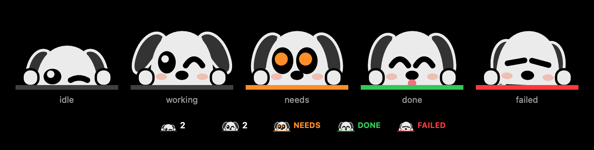

# Peek

A macOS notch overlay that shows your Claude Code sessions and lets you answer them without switching windows.

Peek never delays or replaces the terminal's own prompts: Claude Code asks in the terminal exactly as it does without Peek, and Peek shows the same prompt next to it.

*Peek sits in the notch, stays out of the way, and speaks up when Claude Code needs you.*



## What it shows and does

- Sits in the MacBook notch, or in a small bar at the top of displays without one.
- Stays invisible while no Claude Code session is running, and peeks out when you hover.
- Shows a small one-eyed character. Its pupil follows your cursor and changes with the state of your sessions.
- Expands into a card with one row per session: title, the current tool or latest edit (`file +N −M`), and context usage in percent.
- Jumps to the session's terminal when you click its row.
- Shows each permission request and multiple-choice question in the notch while the terminal shows it too. You can answer in either place, and the first answer counts.
- Approves, denies (with a typed reason) or always-allows permission requests from the notch.
- Answers Claude's multiple-choice questions from the notch.
- Approves plans from the notch.
- Shows your 5-hour and weekly plan usage in the footer.
- Offers global hotkeys, custom sounds, a settings window and a choice of display.

## Requirements

- macOS 14 or later.
- Xcode Command Line Tools with Swift 6 (`xcode-select --install`).
- Claude Code.
- `python3`, which `install.sh` uses to edit `settings.json`.

## Install

```sh
git clone https://github.com/SirCharan/peek.git
cd peek
./install.sh
```

The script does these things, in order:

1. Builds Peek with `swift build -c release`.
2. Works out the changes to `~/.claude/settings.json` and prints them as a diff.
3. Asks whether to write them (`[y/N]`) and stops without changes if you say no. `./install.sh --yes` skips the question.
4. Backs up your original `settings.json` to `~/.claude/backups/` the first time it changes the file.
5. Copies the `peek-hook` binary to `~/.peek/bin/peek-hook`.
6. Writes a LaunchAgent (`com.sircharan.peek`) that starts Peek at login and keeps it running, and loads it.

Peek also wraps your `statusLine` command. It reads the context and plan-usage numbers, then passes the same input to your previous command, so your status line looks the same.

To remove it, run `./uninstall.sh`. If nothing else touched `settings.json` since install, the original file comes back byte for byte. Otherwise only Peek's entries are removed. The script keeps `~/.peek/events`, `~/.peek/status` and the backup.

## Permission prompts

- Automation: macOS asks once for Terminal and once for iTerm2, the first time Peek jumps to a tab in them.
- Hotkeys and hover need no permission. Hotkeys use the Carbon hotkey API, not Accessibility.

## Hotkeys

All five are global and can be changed or cleared in Settings.

| Keys | Action |
| --- | --- |
| Control Option J | Jump to the waiting session (or the most recent one) |
| Control Option A | Allow the first request |
| Control Option D | Deny the first request |
| Control Option P | Open or close the card |
| Control Option M | Mute or unmute sounds |

Allow and Deny only answer when it is clear which request you mean. Multiple-choice questions are never answered by hotkey. The terminal's own prompt is always on screen too, so you can answer there instead.

## Terminals

| Terminal | Click on a row |
| --- | --- |
| Terminal.app, iTerm2 | Selects the exact tab (and can type a reply into it) |
| Ghostty, Warp, kitty, Alacritty, WezTerm, Hyper, Zed, VS Code, Cursor, cmux, Orca, Conductor, T3 Code | Brings the app to the front |

Sessions whose terminal Peek cannot identify fall back to a Terminal.app lookup by title.

## Custom sounds

Peek has three sounds: `needs`, `done` and `fail`. Put a file with one of those names in `~/.peek/sounds/` to replace it. Supported formats are wav, aiff, caf, m4a and mp3. Settings has a button that opens the folder and a play button for each sound.

## How it works

Peek reads only the official Claude Code hooks. `install.sh` registers the `peek-hook` binary for these events:

- Logged without blocking: `SessionStart`, `UserPromptSubmit`, `PreToolUse`, `PostToolUse`, `PostToolUseFailure`, `Notification`, `PreCompact`, `PostCompact`, `SubagentStart`, `SubagentStop`, `Stop`, `StopFailure`, `SessionEnd`.
- Held while the terminal asks: `PermissionRequest`. Claude Code also fires it for multiple-choice questions (`AskUserQuestion`), so one hook covers both.

Non-blocking events are appended to `~/.peek/events/<session>.jsonl`. A `PermissionRequest` goes to the app over the Unix socket `~/.peek/peek.sock`, while Claude Code shows its own prompt in the terminal. If you answer in Peek, the hook returns your answer and Claude Code closes its prompt and carries on. If you answer in the terminal first, Peek sees the session's next event, drops its card and hangs up on the hook, which prints nothing. "Always" reuses the suggestion Claude Code sends with the request, so the rule is saved the way Claude Code would save it.

If Peek is not running, the hook finds no socket, prints nothing and exits. Claude Code then behaves as if Peek were not installed. The hook waits at most about two minutes for Peek, and a missing answer never blocks the terminal.

## Privacy

Peek makes no network calls and no model calls. Everything stays on your machine.

Under `~/.peek/` it stores:

- `events/`: one log per session. Edit text (old and new strings, written content) is kept up to 20 KB per field, so the card can show a diff. Each log is trimmed to its last 200 lines once it passes 400.
- `status/`: context percentage and plan-usage numbers per session.
- `bin/`, `peek.sock`, and the install bookkeeping files.
- `sounds/`: yours, if you add any.

## Known limits

- Answering from the notch relies on Claude Code honouring a hook's answer after its own prompt is already showing. That holds in Claude Code 2.1.325, but the documentation does not promise it. If a later version changes this, answer in the terminal.
- Peek learns that you answered in the terminal from the session's next event, so its card can linger for a moment after you answer there.
- Multi-select answers are sent as a comma-joined string, as the Claude Code docs describe. Some versions may want an array. If so, flip the constant `AskQuestion.multiSelectAsArray` in `Sources/PeekCore/AskQuestion.swift`.
- Launch at login comes from the LaunchAgent that `install.sh` writes. There is no switch for it in System Settings. The Settings window reports whether the LaunchAgent exists.

## Development

```sh
swift build
swift test
bash tests/hook-smoke.sh
```

The smoke script runs the hook, `install.sh` and `uninstall.sh` against a temporary `HOME`, never your real one.

## Credits

Portions of the code are adapted from [Coucou](https://github.com/Louis-CFM/coucou) by Louis Raillé, MIT licensed. The files and commit are listed in `THIRD_PARTY_NOTICES.md`. Peek's character and sounds are its own.

## Licence

MIT. See `LICENSE`.

Not affiliated with Anthropic. Claude is a trademark of Anthropic.
